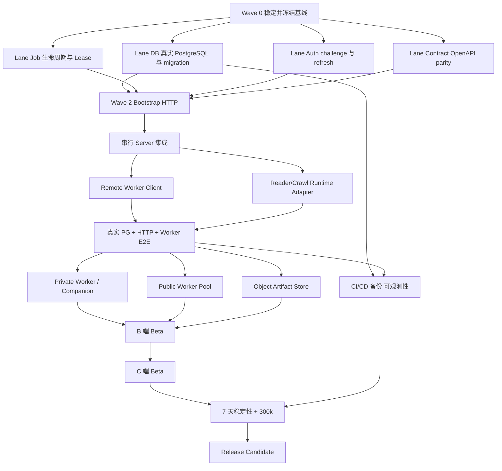

# 方案 C Codex 派发、协作与时限管理手册

日期：2026-09-02

适用范围：Diaoyan 方案 C，从当前控制面工作区推进到 B 端 Beta、C 端 Beta 与 Release Candidate

默认组织：1 个 Coordinator Codex、最多 3 个并行 Worker Codex、1 个人类批准者

文档所有者：Coordinator Codex；其他 Worker 只回报结果，不直接修改本文件

## 1. 目的

本文件不是产品架构的重复说明。目标是让另一组 Codex 在不了解此前对话的情况下，能够：

1. 知道当前代码处于什么状态。
2. 知道哪些工作必须串行，哪些工作可以并行。
3. 获得边界明确、可以复制派发的任务包。
4. 使用同一套完成定义、验证命令和交接格式。
5. 按证据管理时间，而不是使用主观的“完成百分比”。
6. 避免多个 Codex 在同一脏工作区互相覆盖。

产品与架构事实以以下文档为准：

- `docs/hybrid-platform-architecture-plan.md`
- `docs/control-plane-tenancy-adr.md`
- `docs/project-control-api.openapi.yaml`
- `docs/worker-control-api.openapi.yaml`
- `docs/spec.md`

本文件只管理执行顺序、职责、时限、证据和交接。

## 2. 执行模式决策

### 2.1 方案 A：全部串行

一个 Codex 从稳定性、数据库、HTTP、Worker、前端一直做到发布。

优点是冲突少、上下文一致。缺点是关键路径很长，数据库、协议和身份这些互不依赖的任务无法同时推进。适合只有一个执行会话或工作区无法拆分时。

### 2.2 方案 B：最大并行

把所有任务立即分给多个 Codex，同时修改当前工作区。

看起来最快，实际风险最高。当前控制面有大量未提交文件，`server.ts` 和三个接近 800 行的控制面文件又是共享热点。最大并行会造成覆盖、重复实现、OpenAPI 漂移和无法归因的测试失败。

### 2.3 方案 C：波次式混合派发，推荐

使用以下循环：

```text
串行冻结基线
  -> 并行执行互不重叠的任务
  -> 串行集成和全量验证
  -> 形成新基线
  -> 进入下一波并行任务
```

推荐原因：

- 保留并行收益。
- 每个波次都有可恢复的 Git 基线。
- 共享入口文件只由 Coordinator 集成。
- 重型 Browser、SIGKILL 和规模测试保持串行，避免资源竞争伪失败。
- 失败能定位到一个任务、一个提交和一组证据。

## 3. 当前基线

### 3.1 Git 状态

- 当前分支：`fix/crawl-recovery-ssrf-boundaries`
- 当前提交：`7f0b3f04191cb443bfb44287575d125a6f5aa312`
- 控制面主体仍未提交，不能直接从当前提交创建独立 Worker worktree 并获得这些文件。
- 开始多人派发前，必须先完成 Wave 0 并形成一个受保护的控制面 checkpoint。

### 3.2 已存在能力

- 七份 PostgreSQL migration。
- Project、RBAC、API Key、OIDC Session、Worker Identity 服务。
- Job、Lease、Event、Publication、Artifact metadata、Audit 服务。
- Project Job HTTP API 和 Worker HTTP API。
- PostgreSQL Pool 适配器和 `start:control-plane`。
- 两份 OpenAPI 文档。
- 118 个控制面专项测试。

### 3.3 当前 Wave 0 Gate 状态

| ID | 当前证据 | 状态 |
|---|---|---|
| BASE-TS | W0-01 修复 scope readonly 推断；`pnpm check` fresh 通过 | Passing |
| BASE-BROWSER | W0-03 原 15 秒门槛未修改；Coordinator 聚焦用例 1.268 秒 | Passing |
| BASE-ORIGIN | W0-02 保留原 1950ms 断言；恢复 E2E 与相关聚焦测试通过 | Passing |
| BASE-BUILD | Node 25.9 下 `pnpm build` | Passing |
| BASE-CONTROL | 控制面专项 118 tests | Passing |
| BASE-FULL | Node 25.9 串行 fresh Gate：68 files、637/637 tests | Passing |

### 3.4 当前结构性缺口

- API Key HTTP 模块已实现，但尚未接入 `ControlPlaneHttpApi` 和 server 总 Router。
- OIDC、Organization、API Key 管理和 Worker bootstrap HTTP 未接线。
- 没有真实 PostgreSQL migration/concurrency 测试。
- 没有 migration runner 或 schema version gate。
- 没有 Remote Worker 客户端和现有 Reader Runtime 适配。
- Claim 后必须 heartbeat 才能 complete。
- 过期 Lease 依赖下一次 claim 才回收。
- Public Worker、Object Store、SDK、Webhook、C 端产品和运营闭环尚未形成。

## 4. 协作角色

### 4.1 Human Approver

只负责需要真实授权的决定：

- 是否提交、推送、合并和部署。
- 外部数据库、对象存储、OIDC Provider 和云账号凭证。
- Auth、Secret、私有数据上传和发布前安全审核。
- 产品范围、日期和发布级别的最终取舍。

### 4.2 Coordinator Codex

唯一可以修改本派发文档和共享集成入口的角色。

职责：

- 固定每个波次的 base SHA。
- 建立任务、依赖、文件所有权和时间盒。
- 派发任务，不替 Worker 扩大范围。
- 审查 Worker 的提交、测试证据和已知风险。
- 串行完成 `server.ts`、总 Router、package script 和 OpenAPI 汇总接线。
- 运行每个波次的全量 Gate。
- 更新状态账本和关键路径。

### 4.3 Worker Codex

每个 Worker 同时只能拥有一个任务。

职责：

- 只修改任务包授权的文件或目录。
- 先读仓库指令和任务指定文档。
- 先复现 RED，再做最小修改。
- 运行聚焦验证。
- 返回提交 SHA、变更文件、验证输出和剩余风险。
- 不修改总计划、共享状态账本或其他 Lane 的文件。
- 未授权时不 push、不 merge、不部署。

### 4.4 Reviewer Codex

Reviewer 默认只读，不与实现 Worker 共用任务上下文。

职责：

- 对照任务合同审查 diff。
- 检查跨租户、错误处理、数据持久性和 OpenAPI 漂移。
- 核对测试是否使用真实边界，而不只是 mock SQL。
- 给出 `accept`、`changes requested` 或 `blocked`，不直接顺手重写实现。

## 5. Git 与工作区规则

### 5.1 Wave 0 之前

当前未提交控制面代码是所有后续任务的共同输入。不得立即创建多个 Agent 在同一目录写文件。

必须串行完成：

1. 冻结其他写入会话。
2. 修复当前 Gate。
3. 运行 Node 25.9 的 fresh check/build/test。
4. 由用户授权后创建 checkpoint commit。
5. 将 checkpoint SHA 写入本文件的状态账本。

### 5.2 Wave 0 之后

每个并行任务使用独立分支和独立 worktree：

```text
branch:   codex/<task-id>-<short-name>
worktree: ../sc-<task-id>
base:     本波次固定 SHA
```

原则：

- 不在共享工作区并行写文件。
- 不 force-push。
- 不把其他任务的提交顺手带入自己的分支。
- Worker 不直接修改 `src/server.ts`；需要接线时返回集成说明，由 Coordinator 串行处理。
- Worker 不直接修改本派发文档。
- 发生重叠文件需求时，后开始的任务转为 `Blocked`，由 Coordinator 重新切边界。

### 5.3 提交粒度

一个任务通常对应一个可审查提交。提交必须满足：

- 能单独解释目的。
- 不包含其他 Lane 的格式化或清理。
- 聚焦测试通过。
- 没有修改测试门槛来掩盖失败。
- 没有兼容层、额外配置面或未要求的抽象。

## 6. 状态模型与 WIP

任务只允许以下状态：

| 状态 | 含义 |
|---|---|
| Backlog | 已记录，依赖未满足 |
| Ready | 依赖满足，可以派发 |
| In Progress | 已绑定一个 Worker 和开始时间 |
| Review | 实现完成，等待独立审查 |
| Verification | 已审查，等待 Coordinator 集成验证 |
| Blocked | 有明确外部依赖或连续三次同类失败 |
| Done | 已进入基线提交，fresh Gate 有证据 |

WIP 限制：

- 全局最多 3 个 `In Progress`。
- 每个 Codex 最多 1 个 `In Progress`。
- 同一共享组件最多 1 个写任务。
- 重型 E2E 同时最多运行 1 组。
- `Review + Verification` 超过 3 个时停止领取新任务，先清队列。

“代码写完”“本地看起来可用”“测试以前通过”都不能标记 `Done`。

## 7. 时限管理

### 7.1 使用时间盒，不使用虚假精确工期

估算单位：

| 时间盒 | 适用任务 |
|---|---|
| 0.5 天 | 单一测试修复、合同小修、独立路由 |
| 1 天 | 单个服务或一组聚焦端点 |
| 2 天 | 数据库集成、跨模块协议、Remote Worker 子系统 |
| 超过 2 天 | 必须拆成多个可验证任务 |

时间盒到期不自动宣称失败。Worker 必须回报：

- 已完成证据。
- 未完成项。
- 当前阻塞。
- 下一次最小验证动作。
- 是否需要拆任务或改变假设。

### 7.2 默认节奏

- 每个工作日开始：Coordinator 更新 Ready 队列和关键路径。
- Worker 接单后：立即记录 `started_at`、base SHA 和目标验证。
- 连续 4 小时无新证据：必须提交一次状态更新。
- 外部依赖阻塞 2 小时：标记 `Blocked` 并通知 Coordinator。
- 同一问题连续 3 次修复失败：停止编辑，重新检查假设或架构。
- 每日结束：只记录新证据、阻塞时间和实际完成任务，不填写主观百分比。
- 每个波次结束：串行运行全量 Gate，并生成新基线 SHA。

### 7.3 时间字段

状态账本每个任务必须记录：

```text
task_id
owner
base_sha
status
planned_timebox
started_at
target_at
last_evidence_at
blocked_since
finished_at
commit_sha
verification
```

进度使用以下指标：

- Throughput：每周进入基线的任务数。
- Cycle Time：`started_at -> finished_at`。
- Blocked Time：任务处于 Blocked 的总时间。
- Gate Pass Rate：首次进入 Verification 就通过的比例。
- Rework：被 Reviewer 退回的次数。
- Critical Path Age：关键路径上最老未完成任务的时间。

不要使用代码行数、提交数或 Token 数衡量进度。

## 8. 依赖与并行拓扑



关键路径：

```text
Wave 0
-> 真实 PostgreSQL Gate
-> Bootstrap HTTP
-> Server 串行集成
-> Remote Worker 真实闭环
-> B 端 Beta
-> C 端 Beta
-> 7 天稳定性
-> Release Candidate
```

## 9. 波次与任务清单

### Wave 0：稳定和冻结，必须串行

目标：获得可以安全分叉的控制面基线。

| Task | 时间盒 | 内容 | 完成证据 |
|---|---:|---|---|
| W0-01 | 0.5 天 | 修复 API Key scope TypeScript 错误 | `pnpm check` 通过 |
| W0-02 | 1 天 | 诊断并修复重启后同源间隔回归 | 原 1950ms 断言聚焦及全量通过 |
| W0-03 | 1 天 | 诊断授权主导航重定向超时 | 原 15 秒测试稳定通过，不放宽门槛 |
| W0-04 | 0.5 天 | 更新过时审计结论和当前实现状态 | 文档不再声称 HTTP/pg 不存在 |
| W0-05 | 0.5 天 | Node 25.9 fresh Gate 和 checkpoint | check/build/full test 全绿；记录 SHA |

串行原因：当前代码未提交，W0-02 与 W0-03 都涉及最近的 SSRF/恢复提交，必须先稳定再分叉。

Wave Gate：

```bash
git diff --check
fnm exec --using=25.9.0 pnpm check
fnm exec --using=25.9.0 pnpm build
fnm exec --using=25.9.0 pnpm vitest run --maxWorkers=1
```

### Wave 1：Phase 2 基础修复，可三 Lane 并行

#### Lane DB

| Task | 依赖 | 时间盒 | 内容 | 完成定义 |
|---|---|---:|---|---|
| DB-01 | W0 | 1 天 | migration runner、schema version、失败即停止 | 空库按顺序升级；重复运行无漂移；失败不监听 |
| DB-02 | DB-01 | 2 天 | 真实 PostgreSQL integration harness | 七份 migration 在真实 PG 执行；组合 FK、trigger、rollback 通过 |
| DB-03 | DB-02 | 1 天 | 并发与恢复测试 | 并发 claim、sequence、幂等、restart 有真实事务证据 |

文件所有权建议：`migrations/control-plane/`、新建数据库 runner 和 PostgreSQL integration tests。不得同时修改 Job/Auth 领域实现。

#### Lane Job

| Task | 依赖 | 时间盒 | 内容 | 完成定义 |
|---|---|---:|---|---|
| JOB-01 | W0 | 1 天 | 修复 claim→complete 状态语义 | claim 后可直接 complete；heartbeat 仍可续租；旧 generation 失败 |
| JOB-02 | JOB-01 | 1.5 天 | 独立 Lease recovery/sweeper | 没有新 claim 时也能回收过期 Lease；placement 不放宽 |
| JOB-03 | DB-02, JOB-02 | 1 天 | 真实 PG 生命周期测试 | claim、heartbeat、complete、expire、pause/cancel 全链通过 |

文件所有权建议：Job service、Lease service 和对应测试。不要修改 HTTP Router。

#### Lane Auth

| Task | 依赖 | 时间盒 | 内容 | 完成定义 |
|---|---|---:|---|---|
| AUTH-01 | W0 | 1 天 | challenge 验签与消费原子化 | 坏签名不产生 Session；并发只能成功一次；DB 失败可恢复 |
| AUTH-02 | W0 | 1.5 天 | Refresh 并发与 reuse 语义 | 正常并发不全局登出；真实重用仍明确撤销 |
| AUTH-03 | DB-02 | 1 天 | 真实 PG 身份并发测试 | Enrollment、challenge、refresh 的锁与回滚通过 |

Auth、Secret、Cookie 和密钥路径必须由人类进行安全复审。

#### Lane Contract

并行槽只有 3 个时，Contract Lane 在前三条 Lane 任一进入 Review 后启动。

| Task | 依赖 | 时间盒 | 内容 | 完成定义 |
|---|---|---:|---|---|
| API-01 | W0 | 1 天 | OpenAPI 语义 lint 和 Router parity | 每个 operationId 有实现或明确 Planned 标签；CI 可检查 |
| API-02 | API-01 | 1 天 | 补 pause/resume 与错误/状态合同 | OpenAPI、Zod、wire response、测试字段一致 |

Wave 1 Gate：真实 PostgreSQL 测试、控制面专项测试、check/build 和全量测试全部通过。

### Wave 2：Bootstrap HTTP，可三 Lane 并行

前置：Wave 1 Gate 通过。

| Lane | Task | 时间盒 | 授权范围 | 完成定义 |
|---|---|---:|---|---|
| Human Auth | HTTP-01 | 2 天 | OIDC begin/callback/refresh/logout；Secure HttpOnly SameSite Cookie | 浏览器登录、刷新、登出 E2E；无 localStorage |
| Project Admin | HTTP-02 | 2 天 | Organization、Project、API Key create/list/revoke | OpenAPI 端点可调用；Secret 只返回一次 |
| Worker Bootstrap | HTTP-03 | 2 天 | Enrollment、enroll、challenge、session、disable | 新 Worker 不预置数据库即可获得 Session |
| Contract | HTTP-04 | 1 天 | 三组端点的 OpenAPI parity 与 Problem Details | operationId、状态码、字段、scope 一致 |

每个 Lane 新建独立 HTTP 模块。不要继续把业务塞进 `project-http-api.ts`、`organization-service.ts` 或 `api-key-service.ts`。

Wave 2 串行集成：

| Task | 时间盒 | 内容 | 完成定义 |
|---|---:|---|---|
| INT-01 | 1 天 | Coordinator 将新 Router 接入 `server.ts` | 一个 listener 暴露全部 `/v1` 路由，无重复认证 |
| INT-02 | 1 天 | 空库 bootstrap E2E | migration→OIDC user→Project→API Key→Worker Session 全部通过 |

### Wave 3：Remote Worker 与真实 Phase 2 闭环

| Lane | Task | 依赖 | 时间盒 | 完成定义 |
|---|---|---|---:|---|
| Worker Client | RW-01 | INT-01 | 2 天 | Enrollment、Session、claim、heartbeat、terminal 客户端完成 |
| Runtime Adapter | RW-02 | INT-01 | 2 天 | Job Envelope 映射到现有 read/crawl/monitor，不复制抓取算法 |
| Local Durability | RW-03 | RW-01 | 2 天 | Event/Publication 本地 outbox，断网可重试，幂等不重复 |
| Integration | E2E-01 | RW-02, RW-03 | 2 天 | 真 PG + 真 HTTP + 真 Worker 完成公开 read Job |
| Recovery | E2E-02 | E2E-01 | 2 天 | Control/Worker kill-restart，不丢 Job/Event/Publication |

Phase 2 完成 Gate：

```text
一个新用户可以登录
-> 创建 Project/API Key
-> 注册 Worker
-> 通过公开 REST 创建 Job
-> Worker claim 并调用真实 Reader
-> 发布 Publication 并提交 terminal
-> 用户查询到结果
-> 任一进程重启后状态仍一致
```

在此 Gate 通过前，不开始 C 端 UI，也不引入 Kafka、Kubernetes 或正式账单。

### Wave 4：Private/Public Worker 与 Artifact，可三 Lane 并行

| Lane | Task | 时间盒 | 完成定义 |
|---|---|---:|---|
| Private | PRIV-01 | 2 天 | Companion 使用本地 Profile；Cookie/Profile/正文默认不上传 |
| Private | PRIV-02 | 2 天 | pinned placement、offline、disable、key rotate，不降级公共 Worker |
| Artifact | ART-01 | 2 天 | Object Store 写入、内容 Hash、Project 所有权 |
| Artifact | ART-02 | 1.5 天 | 签名下载、retention、删除和失败回滚 |
| Public | PUB-01 | 2 天 | Public Worker pool 执行公开 read/crawl |
| Quota | UQ-01 | 1.5 天 | 并发 Job、页面、Browser 和存储配额 |
| Security E2E | E2E-03 | 2 天 | 跨租户、抓包、私有上传批准、Worker 离线矩阵 |

Wave 4 Gate：公开任务可云端自助执行；私有任务的数据边界有真实网络和存储证据。

### Wave 5：B 端 Beta

| Lane | Task | 时间盒 | 完成定义 |
|---|---|---:|---|
| REST | B-REST-01 | 2 天 | monitors、usage、worker 管理等剩余 REST v1 |
| MCP | B-MCP-01 | 2 天 | Cloud MCP 是 REST 薄适配器，结果 parity |
| SDK | B-SDK-01 | 2 天 | TypeScript SDK、重试、cursor、示例应用 |
| Webhook | B-WH-01 | 2 天 | 签名、outbox、重试、禁用、回放 |
| Docs | B-DOC-01 | 1.5 天 | API 文档、Quickstart、错误和幂等说明 |
| Beta Gate | B-E2E-01 | 2 天 | 示例应用只用公开合同完成 read/crawl/monitor |

B 端 Beta 不要求正式收费，但 Usage、预算和审计必须可查询且不可静默降级。

### Wave 6：C 端 Beta

| Lane | Task | 时间盒 | 完成定义 |
|---|---|---:|---|
| Web | C-WEB-01 | 2 天 | 登录、Project、API Key、Job 创建/详情 |
| Web | C-WEB-02 | 2 天 | Publication、Artifact、Monitor、错误恢复 |
| Extension | C-EXT-01 | 2 天 | 当前页公开/授权数据分类与本机路由 |
| Companion | C-COMP-01 | 2 天 | 安装、Enrollment、状态、任务、升级提示 |
| Privacy UX | C-PRIV-01 | 1.5 天 | 明确显示数据位置和单 Job 上传批准 |
| C E2E | C-E2E-01 | 2 天 | 新用户无需 CLI 完成公开读取；授权页明确走本机 |

### Wave 7：运营和发布

这些工作可以在 Wave 3 后逐步并行准备，但发布 Gate 必须最后串行判定。

| Task | 时间盒/历时 | 完成定义 |
|---|---:|---|
| OPS-01 | 2 天 | PR CI、OpenAPI lint、真实 PG integration、重型 E2E 分组 |
| OPS-02 | 2 天 | Dashboard、alert、structured logs、runbook |
| OPS-03 | 2 天 | PostgreSQL/Object/Worker backup 与 restore 演练 |
| OPS-04 | 1.5 天 | 镜像、Secret、灰度、回滚和 schema rollout |
| REL-01 | 7 个自然日 | 7 天稳定性，无状态丢失，SLO 与成本有报告 |
| REL-02 | 2 天 | 300,000 页压力测试和资源曲线 |
| REL-03 | 2 天 | 私有 Release Corpus 和同 Corpus 对照 |
| REL-04 | 1 天 | Release Candidate 证据审查 |

## 10. 默认里程碑与日历预算

以下是假设 3 个 Worker Codex、1 个 Coordinator、外部凭证及时提供的规划范围，不是承诺日期。

| 里程碑 | 建议工作日 | 累计范围 |
|---|---:|---|
| M0 稳定 checkpoint | D1-D3 | Wave 0 |
| M1 Phase 2 基础修复 | D4-D7 | Wave 1 |
| M2 Bootstrap HTTP | D8-D12 | Wave 2 |
| M3 真实 Remote Worker 闭环 | D13-D18 | Wave 3 |
| M4 Private/Public/Artifact | D19-D28 | Wave 4 |
| M5 B 端 Beta | D29-D37 | Wave 5 |
| M6 C 端 Beta | D38-D50 | Wave 6 |
| M7 Release Candidate 最早窗口 | D51-D65 | Wave 7 与 7 天稳定性 |

调整方法：

- 只有 1 个 Codex：按 Task ID 完全串行，预计周期约为表中 1.8-2.5 倍。
- 2 个 Codex：DB 与 Job/Auth 交替，Coordinator 同时承担 Review。
- 3 个 Codex：使用本文默认波次。
- 超过 3 个 Codex：不要增加写入 WIP；额外 Agent 只做只读审查、测试矩阵和文档核对。

## 11. 每个任务的派发包

复制以下模板给 Worker Codex，删除无关说明并填写全部字段：

```markdown
# Task <TASK-ID>: <标题>

## Objective
一句话描述必须实现的可观察结果。

## Base
- Repository: <repository-root>
- Base branch: <branch>
- Base SHA: <sha>
- Worktree: <path>
- Timebox: <0.5/1/2 day>

## Read first
- AGENTS.md instructions from the dispatch message
- <相关 ADR/OpenAPI/spec>
- <相关源码和测试>

## Authorized scope
- 可以修改：<明确文件或目录>
- 可以新增：<明确文件>
- 不得修改：src/server.ts、总派发文档、其他 Lane 文件

## Required behavior
1. <行为一>
2. <行为二>
3. <错误与失败语义>

## Non-goals
- <本任务不做什么>
- 不增加兼容层、额外配置面或推测性抽象。

## Required tests
1. 先增加或确认失败测试。
2. 运行：<聚焦命令>
3. 运行：fnm exec --using=25.9.0 pnpm check
4. 不运行与本任务无关的重型全量测试；由 Coordinator 串行执行。

## Definition of done
- 所有要求行为有自动化证据。
- 错误不被 warning + fallback 吞掉。
- 没有跨租户或 Secret 泄漏。
- 聚焦测试和 typecheck 通过。
- 返回提交 SHA 和 handoff。

## Handoff format
- Status: done / blocked
- Commit SHA:
- Changed files:
- Fresh verification:
- Decisions made:
- Remaining risks:
- Integration notes:
```

## 12. 初始可直接派发的任务

当前还不能开启三个写入 Agent，因为 Wave 0 未完成。第一个 Coordinator 应先派发以下串行任务：

```markdown
# Task W0-01: 恢复 TypeScript Gate

Objective: 修复 tests/control-plane-oidc-session-service.test.ts 中 API Key scope
的类型推断，使 Node 25.9 下 pnpm check 通过，不改变运行时行为。

Authorized scope:
- tests/control-plane-oidc-session-service.test.ts

Non-goals:
- 不修改生产 Auth 语义。
- 不修改 API Key scope 类型定义。
- 不处理其他测试失败。

Required verification:
- fnm exec --using=25.9.0 pnpm check
- fnm exec --using=25.9.0 pnpm vitest run tests/control-plane-oidc-session-service.test.ts
```

W0-01 完成后派发：

```markdown
# Task W0-02: 修复重启后的 origin interval 回归

Objective: 保证 Worker SIGKILL/restart 后，同 origin 请求起始间隔继续满足现有
1950ms 断言，不降低断言、不增加静默等待兜底。

Read first:
- tests/e2e/crawl-recovery.e2e.test.ts
- src/runtime/frontier.ts
- src/frontier-store.ts
- 7f0b3f0 diff

Required method:
- 先定位持久化时间、重启时间和调度时间的实际差值。
- 挑战最近 SSRF/恢复修改的假设，不随机增加 sleep。

Required verification:
- 原失败测试连续 fresh 通过。
- crawl graceful recovery 和 frontier store 聚焦测试通过。
```

随后派发：

```markdown
# Task W0-03: 修复授权主导航拒绝测试超时

Objective: 保证授权浏览器主导航重定向到未授权 origin 时快速明确失败，原 15 秒门槛内
稳定通过，且 denied origin 不收到请求。

Read first:
- tests/browser-authorization.test.ts
- src/fetch/browser.ts
- src/security/policy-egress-proxy.ts

Required method:
- 区分策略拒绝、代理连接、Chrome 关闭和测试清理阶段的耗时。
- 不通过延长超时解决。

Required verification:
- tests/browser-authorization.test.ts
- tests/policy-egress-proxy.test.ts
- controlled js-shell-browser case
```

## 13. Review 清单

Reviewer 对每个提交至少核对：

### 合同

- OpenAPI、Zod、TypeScript 类型和 wire response 字段是否一致。
- 状态码、错误码、幂等键和 cursor 是否一致。
- 是否有声明但没有 Router 的 operationId。

### 数据完整性

- Project 资源查询是否包含 `project_id`。
- 写入与 Audit/Usage 是否处于同一事务。
- 重试、重启和幂等是否使用同一权威状态。
- 是否存在 mock 测试掩盖真实 PostgreSQL 行为。

### 安全

- Secret、Cookie、Authorization Header、Worker 私钥和正文是否可能进入日志、Audit 或普通 Job payload。
- 私有数据是否只在单 Job 明确批准后上传。
- Auth、API Key、Worker Session 是否 fail-closed。
- SSRF 检查是否覆盖最终连接地址，而不只覆盖预解析。

### 错误处理

- 用户可见失败是否明确返回 error。
- 是否有 warning + 空成功、空 catch 或错误后继续提交。
- 回滚失败是否被保留而不是覆盖原错误。

### 范围

- 是否只做任务要求。
- 是否新增了不必要的抽象、配置、兼容层或旧数据迁移。
- 是否修改测试门槛来制造绿色结果。

## 14. 波次 Gate

每个 Worker 只负责聚焦验证。以下 Gate 只能由 Coordinator 在合并候选基线上串行执行：

```bash
git status --short --branch
git diff --check
fnm exec --using=25.9.0 pnpm check
fnm exec --using=25.9.0 pnpm build
fnm exec --using=25.9.0 pnpm vitest run --maxWorkers=1
```

当真实 PostgreSQL harness 建立后，还必须增加该仓库实际提供的 migration/integration 命令。命令应由 DB-02 在 package scripts 或测试说明中固定，不能依赖口头步骤。

Gate 失败时：

1. 记录第一个失败命令和原始错误。
2. 定位到引入失败的最小任务集合。
3. 把对应任务退回 `In Progress`。
4. 不继续合并后续任务。
5. 不放宽断言、跳过测试或标记“环境问题”后继续。

## 15. 状态账本模板

Coordinator 在自己的集成分支维护以下表。初始值如下：

| Task | Owner | Base SHA | Status | Timebox | Started | Target | Last evidence | Blocked since | Commit | Verification |
|---|---|---|---|---:|---|---|---|---|---|---|
| W0-01 | Coordinator | 7f0b3f0 | Verification | 0.5d | 2026-09-03 | 2026-09-03 | readonly scope fix; focused 22/22; check passed | - | - | reviewer accepted; awaiting checkpoint |
| W0-02 | Coordinator | 7f0b3f0 | Verification | 1d | 2026-09-03 | 2026-09-03 | recovery E2E 2/2; related tests 26/26; check/build passed | - | - | reviewer accepted; awaiting checkpoint |
| W0-03 | Coordinator | 7f0b3f0 | Verification | 1d | 2026-09-03 | 2026-09-03 | target 1.268s; browser 3/3; proxy 4/4; controlled case 1/1 | - | - | no-op reviewer accepted; awaiting checkpoint |
| W0-04 | Coordinator | 7f0b3f0 | Verification | 0.5d | 2026-09-03 | 2026-09-03 | stale audit and implementation claims corrected | - | - | reviewer accepted; awaiting checkpoint |
| W0-05 | Coordinator | 7f0b3f0 | Verification | 0.5d | 2026-09-03 | 2026-09-03 | check/build passed; serial full Gate 68 files, 637/637 | - | - | data/security review accepted; awaiting checkpoint |
| DB-01 | unassigned | W0 checkpoint | Backlog | 1d | - | - | dependency unmet | - | - | - |
| JOB-01 | unassigned | W0 checkpoint | Backlog | 1d | - | - | dependency unmet | - | - | - |
| AUTH-01 | unassigned | W0 checkpoint | Backlog | 1d | - | - | dependency unmet | - | - | - |

不要让所有 Worker 在各自分支修改这张表。Worker 使用 handoff 消息回报，Coordinator 统一更新。

## 16. 阻塞与升级规则

以下情况立即阻塞，不自行假设：

- 需要数据库、OIDC、对象存储或云账号凭证。
- 需要修改另一个 Lane 已拥有的文件。
- 任务要求与 OpenAPI/ADR 冲突。
- Auth、支付、Secret 或私有数据边界需要扩大。
- 需要删除、覆盖、迁移现有用户数据。
- 同一问题连续三次修复失败。

阻塞报告格式：

```markdown
Status: blocked
Task: <ID>
Last known good SHA: <sha>
Blocking condition: <一个具体事实>
Evidence: <命令和错误>
Safe work completed: <已经完成的只读或不依赖部分>
Decision required: <只问一个会改变方向的问题>
Options:
1. <推荐选择及影响>
2. <替代选择及影响>
```

## 17. 完成与发布判定

### Phase 2 Done

- 空 PostgreSQL 可以通过正式 migration 初始化。
- 用户、Project、API Key 和 Worker 可以从公开 HTTP bootstrap。
- Remote Worker 使用真实网络完成 Job。
- 重启不丢状态。
- OpenAPI 与实现 parity Gate 通过。
- 全量测试通过。

### B 端 Beta Done

- 外部示例应用只使用 REST/MCP/SDK 完成 read/crawl/monitor。
- Idempotency、cursor、Webhook、Usage 和 Audit 有真实 E2E。
- API 文档与错误语义稳定。

### C 端 Beta Done

- 新用户无需 CLI 完成公开读取。
- 授权页面明确路由到本机 Worker。
- 用户可看到 Job、结果、错误、数据位置和上传批准。

### Release Candidate Done

- CI/CD、备份恢复、可观测性和回滚演练通过。
- 7 天稳定性试验通过。
- 300,000 页压力测试有当前 SHA 证据。
- 私有 Release Corpus 通过。
- Auth、Secret、私有上传和发布配置完成人工安全复审。

在这些 Gate 之前，不使用“已完成方案 C”“生产可用”或“已交付 C/B 端”的表述。

## 18. Coordinator 每日汇报模板

```markdown
# YYYY-MM-DD Status

Current baseline: <sha>
Current wave: <wave>
Critical path task: <task-id>

Done today:
- <task + evidence + commit>

In progress:
- <task + owner + last evidence + target>

Blocked:
- <task + since + decision required>

Gate status:
- check:
- build:
- focused tests:
- full tests:
- real PostgreSQL:

Schedule:
- milestone:
- planned window:
- current forecast:
- variance reason:

Next dispatch:
1. <task>
2. <task>
3. <task>
```

汇报只写事实和证据。时间预测变化时，记录依赖、阻塞或返工原因，不通过压缩测试和 Review 时间追回日期。
