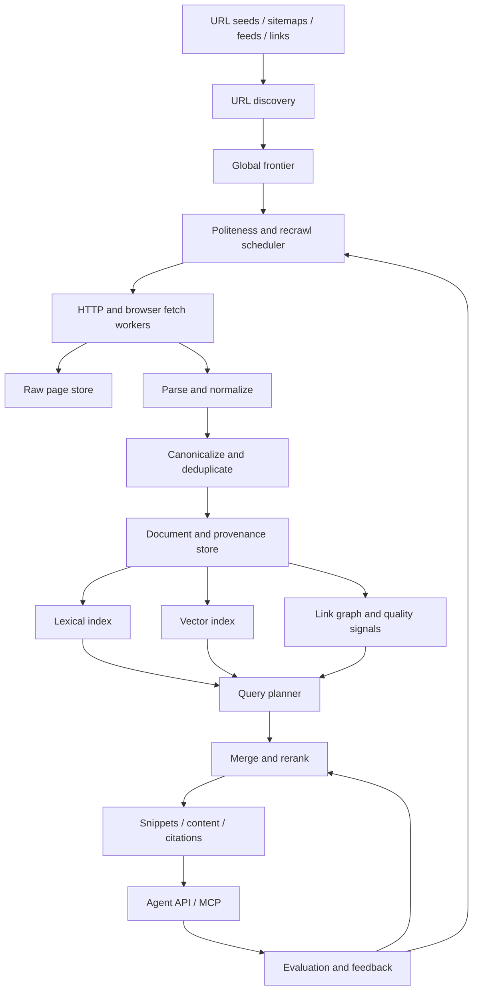
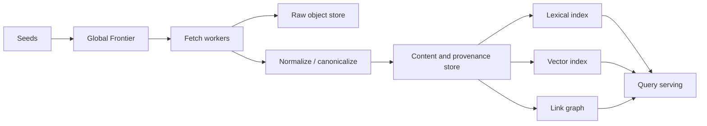
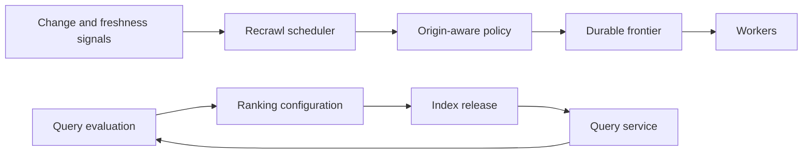

# Brave、Firecrawl、Exa 搜索架构全景与自主搜索路线

状态：Architecture Research
研究日期：2026-08-30
适用项目：Diaoyan / FetchTrail
相关文档：[爬虫技术架构全景](./crawler-architecture-landscape.md)、
[技术选型 RFC](./technology-selection-rfc.md)、[本地搜索规范](./local-search-spec.md)

## 1. 研究问题与结论

本文件回答四个问题：

1. Brave Search、Firecrawl、Exa 实际分别是什么系统。
2. 它们的数据从哪里来，哪些能力真正由自己拥有。
3. Firefox 是否属于同一类产品。
4. Diaoyan/FetchTrail 如果以“自主搜索引擎 C”为终极目标，应该补齐哪些架构层。

结论是：三款看起来都能“搜索并读取网页”的产品，实际上处于不同系统层。

| 系统 | 本质 | 自有全网索引 | 主要优势 | 对本项目的意义 |
| --- | --- | --- | --- | --- |
| Brave Search | 通用全网搜索引擎 | 是 | 独立抓取、网页索引、传统排序、浏览器反馈信号 | 学习数据自主权、网页发现和持续更新 |
| Firecrawl | 网页获取与内容清洗平台 | 开源自托管版没有 | 浏览器渲染、抓取、清洗、批处理、任务编排 | 与当前项目的获取执行层最接近 |
| Exa | 面向 AI 的神经搜索引擎 | 是 | 混合检索、自研 embedding/reranker、向量数据库和查询编排 | 学习 AI-native 索引、排序和评测 |
| Firefox | 浏览器与搜索提供商管理器 | 否 | 浏览器 UI、地址栏、搜索引擎配置 | 不是搜索后端竞品 |

因此不存在一套可以整体照搬的“最好技术”。对本项目更合理的组合是：

- 获取和内容交付层参考 Firecrawl。
- 独立发现、数据所有权和持续更新参考 Brave。
- 混合索引、语义排序、查询编排和评测参考 Exa。
- 复制正确的系统边界，不复制竞品已经到达的超大规模。

## 2. 方法与证据边界

本文只使用官方源码、官方文档、官方技术文章和产品合同作为架构事实来源。

| 标签 | 含义 |
| --- | --- |
| Verified | 可由源码、官方技术文档或可重复测量直接支持 |
| Inferred | 证据支持该判断，但厂商没有直接公开内部实现；必须说明推理 |
| Unknown | 公开资料不足，不能用营销描述补全 |

需要特别避免四种误判：

1. 有公开 SDK、MCP 或客户端，不等于核心搜索引擎开源。
2. 提供 `/search` 接口，不等于拥有搜索结果背后的全网索引。
3. 可以 self-host，不等于发现源、数据、模型和控制面全部独立。
4. 浏览器、Scraper、Search Index 和 Answer Engine 可能共享一个搜索框，但解决的是不同层。

官方披露的索引规模也不能直接横向排名。不同厂商所说的“页面数”可能分别代表抓取过的页面、
处理流水线中的页面、可服务索引或历史版本总量。

## 3. 搜索系统的完整分层

一个自主搜索引擎不是“搜索 API + 网页读取器”，而是下列长期运行的数据闭环：



Firecrawl 主要覆盖 Fetch、Render、Parse、Delivery；Brave 与 Exa 还拥有 Discovery、长期数据存储、
Index、Ranking 和 Query Serving。这个边界差异是本研究最重要的结论。

## 4. Brave Search

### 4.1 已证实的系统边界

Brave 官方确认其搜索结果来自自己的独立 Web 索引，而不是将 Google 或 Bing 结果重新包装。
Brave 自己运行网页抓取器、维护索引和排名模型，并通过网页搜索和 Search API 提供查询结果。

官方当前产品页宣称索引包含超过 300 亿页面，每天处理超过 1 亿次页面更新。这是厂商披露，说明其
系统数量级，但未公开统计口径，不能据此与 Exa 做严格排名。

来源：

- [Brave Search API](https://brave.com/search/api/)
- [Brave Search 独立索引说明](https://brave.com/blog/search-independence/)
- [Brave Search crawler](https://search.brave.com/help/brave-search-crawler)

### 4.2 Web Discovery Project

Brave 的独特数据入口是浏览器内自愿加入的 Web Discovery Project（WDP）。它可以提供：

- 用户见到的搜索结果和结果 URL。
- 用户访问的公开 URL 和页面元数据。
- 搜索结果点击、页面停留等聚合质量信号。
- 普通 crawler 不容易及时发现的长尾页面。

```text
用户浏览器（opt-in）
        │
        ├─ 查询与搜索结果
        ├─ 公开 URL 和页面元数据
        └─ 聚合访问/质量信号
        │
        ▼
客户端隐私过滤和聚合
        │
        ▼
WDP 服务
        │
        ├─ URL discovery
        ├─ 页面质量信号
        └─ 长尾覆盖改进
```

WDP 客户端开源，并通过阻止记录关联、客户端聚合和 STAR 协议降低数据与具体用户关联的风险。
STAR 组合对称加密、Shamir secret sharing 和 VOPRF，使只有达到一定重复度的数据可以被恢复。

来源：

- [Web Discovery Project 源码](https://github.com/brave/web-discovery-project)
- [WDP 方法与消息说明](https://github.com/brave/web-discovery-project/blob/main/modules/web-discovery-project/sources/README.md)
- [STAR 隐私协议](https://brave.com/privacy-updates/19-star/)

### 4.3 查询与重新排序

Brave 的基础排名模型没有开源。公开的 Goggles 位于基础排名之后，允许用户或社区根据域名和规则
过滤、boost 或 downrank 结果。因此 Goggles 是 reranking 配置，不是 Brave 主索引和主排名算法。

来源：[Brave Goggles](https://brave.com/goggles/)

### 4.4 Brave 真正的护城河

Brave 最难复制的不是 API，而是长期形成的数据资产和运行闭环：

- 持续增长的 URL 集合和抓取历史。
- 页面变化频率、重抓优先级和版本信息。
- 域名、链接图、垃圾内容和 SEO 质量信号。
- 真实用户提供的长尾发现和相关性反馈。
- 多语言、地域、新闻和时间敏感查询的排序。
- 长期运行的抓取、索引发布和在线查询基础设施。

### 4.5 公开资料无法证明的部分

以下生产系统没有完整开源，应标记为 Unknown：

- 全局 URL frontier 和分布式抓取后端。
- 原始网页、历史版本和索引构建存储。
- 主排序模型、spam 检测和链接质量算法。
- 生产查询集群、分片和索引发布方式。

Brave 可以作为自主搜索引擎目标参考，但不是可以直接 fork 的搜索后端。

## 5. Firecrawl

### 5.1 产品定位

Firecrawl 更准确的定义是：取得已知网页或搜索结果 URL，并转换成适合 AI 使用的 Markdown、JSON、
截图或结构化数据。它提供 Search、Scrape、Crawl、Map、Batch Scrape、Interact 和 Agent 等接口。

来源：[Firecrawl 官方仓库](https://github.com/firecrawl/firecrawl)

### 5.2 开源自托管架构

当前官方自托管部署包括：

- TypeScript API 和 worker。
- 独立 Playwright 浏览器服务。
- Redis 缓存、状态和限流。
- RabbitMQ 通知/队列组件。
- PostgreSQL/NuQ 队列。
- 可选 FoundationDB 队列后端。

这套架构主要解决异步抓取、浏览器渲染、任务状态、并发、失败重试和结果清洗。

来源：

- [Firecrawl SELF_HOST](https://github.com/firecrawl/firecrawl/blob/main/SELF_HOST.md)
- [Firecrawl Compose](https://github.com/firecrawl/firecrawl/blob/main/docker-compose.yaml)

### 5.3 `/search` 的真实数据来源

Firecrawl 开源版当前 `search/v2/index.ts` 源码按以下顺序选择搜索来源：

```text
配置 FIRE_ENGINE_BETA_URL
    → Fire Engine
否则配置 SEARXNG_ENDPOINT
    → SearXNG
否则
    → DuckDuckGo
```

因此，开源自托管 Firecrawl 没有自己的全网搜索索引。它从其他搜索来源取得 URL，然后用自己的
Scrape 能力读取和清洗结果页。托管 Fire Engine 的内部数据来源没有完全公开，不能推定为 Firecrawl
拥有的独立全网索引。

来源：

- [Firecrawl v2 search 实现](https://github.com/firecrawl/firecrawl/blob/main/apps/api/src/search/v2/index.ts)
- [Firecrawl SearXNG adapter](https://github.com/firecrawl/firecrawl/blob/main/apps/api/src/search/v2/searxng.ts)

当前源码还会在搜索异常时记录错误并返回空对象。这可能使调用方无法区分“没有搜索结果”和“搜索
后端失败”。Diaoyan 不应复制这种 failure contract，应继续坚持错误可见。

### 5.4 Firecrawl 值得复用与不应误判的部分

值得参考：

- HTTP、浏览器、代理和渲染执行器隔离。
- 异步 crawl/batch job 和统一产品接口。
- HTML 到 Markdown/JSON 的内容清洗。
- 面向 Agent 的 SDK、CLI 和 MCP 交付。

不能据此得出的结论：

- Self-host Firecrawl 等于拥有搜索数据。
- `/search` 等于独立全网搜索引擎。
- 公开 API 表面等于托管生产基础设施全部开源。

Firecrawl 回答“怎样可靠拿回一个网页”，不完整回答“怎样发现并维护整个 Web 的知识索引”。

## 6. Exa

### 6.1 数据获取层

Exa 官方公开的基础流水线是：持续发现 URL，在分布式机器和 IP 上抓取，自研 HTML parser 处理，
原始文档存入 S3，然后生成文本、元数据和检索特征。

```text
URL discovery
    ↓
Distributed crawler fleet
    ↓
Custom HTML parser
    ↓
S3 raw document storage
    ↓
Quality filtering and feature generation
```

来源：[Exa 下一代搜索架构](https://exa.ai/blog/how-to-build-nextgen-search)

Exa 没有完整公开 URL 种子、抓取覆盖和质量筛选算法，因此这些细节仍是 Unknown。

### 6.2 exa-d 数据处理框架

Exa 2026 年公开的内部 `exa-d` 负责维护网页索引的大量派生产物：

- 将网页、文本、元数据、token、embedding 和搜索信号表示成类型化列。
- 使用声明式依赖图表达数据派生关系。
- 支持只更新受影响的行和列。
- 支持新模型上线时进行全量重建。
- 使用 Ray Data 在 CPU、GPU 和多节点之间并行执行。
- 根据已存在和缺失的输出继续计算，避免失败后全部重跑。

这套设计解决的是长期索引最容易被忽略的问题：同一页面会产生许多派生特征，页面变化、解析器
修复和模型升级都会触发不同范围的重算。

来源：[exa-d: Data Framework to Process the Web](https://exa.ai/blog/exa-d)

### 6.3 混合索引与排序

Exa 并不是只使用向量搜索。公开材料明确说明它同时维护：

- BM25/倒排索引，用于关键词、专有名词和精确匹配。
- 自研 embedding 模型，用于长查询和语义召回。
- Metadata inverted index，用于域名、时间和内容类型过滤。
- Reranker，用于对第一阶段候选进行更精确的重排。
- 网页分块和 Highlights，用于返回与二级查询最相关的段落。

来源：

- [Exa BM25 优化](https://exa.ai/blog/bm25-optimization)
- [Exa Highlights](https://exa.ai/blog/announcing-exa/)
- [Exa 搜索评测](https://exa.ai/blog/evals-at-exa)

这说明面向 AI 的搜索仍然需要 lexical retrieval。Embedding 是新增的召回和理解能力，不是对倒排
索引的完全替代。

### 6.4 自研向量数据库

Exa 公开的向量数据库设计包括：

- 数十亿级文档向量。
- Embedding 截断和二值量化。
- 通过聚类缩小候选集合。
- Metadata inverted index 与向量检索组合。
- 第一阶段使用压缩表示召回，随后以更完整的向量重排。
- 针对内存布局、SIMD 和低层操作优化。

来源：[Exa Web-scale vector database](https://exa.ai/blog/building-web-scale-vector-db)

这不是本项目现阶段应该复制的组件。Exa 是在通用方案无法满足其数十亿向量、延迟和单位成本目标
之后才自研数据库。Diaoyan 只有在真实负载证明现有索引成为瓶颈后，才应考虑同类投入。

### 6.5 Canon 查询编排

Exa 2026 年公开的 Canon 将搜索请求表示成类型化执行 DAG。不同查询可以选择关键词索引、向量
索引、新鲜度模型、知识图谱和客户过滤，再进行合并与 rerank。

Canon 支持：

- 惰性执行和取消不再需要的计算。
- 独立节点并行执行。
- 公共祖先结果 memoization。
- 类型系统检查未处理的节点结果。
- 每次查询留下完整 trace。

来源：[Composing a Search Engine](https://exa.ai/blog/composing-a-search-engine)

它解决的是检索路径越来越复杂之后的可观察性和正确性问题。早期项目不需要复制完整 typed DAG，
但应从第一天保留每个检索阶段的来源、候选数、耗时、过滤原因和排序版本。

### 6.6 Exa 的公开边界

Exa 的 crawler、embedding 模型、reranker、向量数据库和生产查询系统是闭源商业核心。工程文章可以
证明系统形态，但不能当作可直接部署的实现。其 GPU 集群和自研数据库也说明，Exa 级别的搜索质量
不仅是软件架构问题，还依赖长期数据、训练语料、评测集和大量计算资源。

## 7. 如果用户字面上指 Firefox

Firefox 是浏览器，不是搜索引擎后端。Firefox Search Service 管理区域默认搜索引擎、用户选择、
地址栏搜索和搜索建议。查询和建议仍由所选的 Google、Bing 或其他 provider 处理。

来源：

- [Firefox Search Service](https://firefox-source-docs.mozilla.org/toolkit/search/index.html)
- [Firefox SearchService overview](https://firefox-source-docs.mozilla.org/toolkit/search/SearchServiceHighlevelOverview.html)

Firefox 值得研究的是搜索入口、provider 配置和浏览器体验，不是 crawler、index 或 ranking 后端。
在本项目此前语境中，“Firefox”更可能是“Firecrawl”的口误，因此主体比较采用 Firecrawl。

## 8. Diaoyan/FetchTrail 当前所处位置

当前项目已具备：

- `search_web`、`read_page`、`inspect_page`、站内 map/crawl。
- 持久 crawl job、SQLite frontier、暂停/恢复/取消和游标交付。
- HTTP 与浏览器读取路径。
- 可选 SQLite FTS5 本地索引。
- SearXNG `SearchProvider` 实现。
- 来源、内容证据、失败和运行指标。

来源：[项目 README](../README.md)、[Search 实现](../src/search.ts)。

当前搜索数据流是：

```text
用户或 Agent 给出 URL
        │
        ├─ 站内链接发现
        ├─ SearXNG 返回 URL
        └─ 已经读取过的本地页面
        │
        ▼
Diaoyan 抓取、验证和解析
        │
        ▼
可选 SQLite FTS5
```

因此，本项目已经接近 Firecrawl 的获取执行层，但还不是 Brave/Exa 意义上的自主搜索引擎。

| 能力层 | 当前状态 | 达到目标 C 所需变化 |
| --- | --- | --- |
| 已知 URL 获取 | 已具备 | 继续提升可靠性和执行成本 |
| 站内发现 | 已具备，bounded | 增加跨站点和长期 frontier |
| 搜索发现 | SearXNG 或本地已读页面 | 建立自己的 URL corpus 和增量发现 |
| 原始数据 | 以读取产物和任务状态为主 | 保存原始响应、页面版本和 provenance |
| 索引 | SQLite FTS5，本地可选 | 可演进的 lexical、vector、link indexes |
| 排序 | 本地 FTS/SearXNG 顺序 | 自有混合召回、质量信号和 reranker |
| 评测 | 抓取可靠性 Benchmark 正在建设 | 增加固定搜索 query set 和 relevance judgments |

## 9. 目标 C：自主搜索引擎架构

目标 C 的定义应是：查询运行时不依赖 Brave、Exa、Google、Bing 或 SearXNG 才能发现核心结果，
并且网页数据、索引和排序主要由本项目拥有和维护。

这不要求第一天覆盖整个互联网。数据自主权和全球规模是两个不同目标：

- 可以先对有限领域拥有 100% 自主数据和索引。
- 不能因为使用了自托管 SearXNG 就宣称拥有搜索数据。
- 可以使用 sitemap、RSS、链接和公开数据集作为启动种子，但核心查询不能永久依赖外部实时搜索
  provider。

目标架构分为数据面和控制面。

### 9.1 数据面



必要能力：

- URL identity、canonical 和 redirect 关系。
- 内容 hash、近似重复和跨域重复检测。
- 原始 HTML/PDF、解析正文、来源和处理版本。
- Lexical index、可选 vector index、link/quality signals。
- 可重建的派生索引，而不是只保存最终 Markdown。

### 9.2 控制面



必要能力：

- 按 origin 的礼貌、速率、预算和失败退避。
- 根据页面变化频率安排重抓。
- 索引版本、构建状态、发布和回滚。
- 查询阶段 trace、排名版本和结果 provenance。
- 固定 query set、relevance judgment 和回归门槛。

## 10. 分阶段建设路径

### Phase 1：自主垂直索引

先选择一个有限领域，例如技术文档、AI 工具、论文或明确站点集合。

完成标准：

- 不依赖 Brave、Exa 或 SearXNG 完成该领域的核心查询。
- 自己维护 seeds、frontier、抓取时间和 lexical index。
- 建立固定搜索 query set 和人工可检查的期望结果。
- 支持每天增量更新，失败显式可见。

这个阶段继续复用当前 TypeScript、SQLite frontier 和抓取执行层，不引入分布式系统。

### Phase 2：长期网页数据层

增加：

- 原始响应或 WARC-like 存储。
- 页面版本、内容 hash 和 canonical URL。
- 跨页面、跨域重复检测。
- Parser/indexer 版本和可重建派生产物。
- 根据变化历史计算重抓优先级。

完成后，项目拥有持续增长的网页数据库，而不只是一次性网页读取结果。

### Phase 3：混合检索

使用同一查询集依次验证：

1. 纯 BM25/lexical baseline。
2. BM25 + embedding 召回。
3. BM25 + embedding + lightweight reranker。
4. 新鲜度、域名质量和链接信号是否带来可测收益。

不能在没有 query set 和 benchmark 的情况下预先认定向量数据库、自研模型或某个搜索产品是正确
答案。OpenSearch、Tantivy、Meilisearch、Qdrant 等候选应单独进行源码、运维和同任务测试后选型。

### Phase 4：开放 Web 与多节点

只有单机索引和搜索质量得到验证后，再增加：

- 多域名和跨站点 global frontier。
- 分布式 fetch/index worker。
- 域名和 IP 级 politeness。
- 爬虫陷阱、spam 和低质量页面识别。
- 多语言、地域和时间敏感索引。
- 分片、复制和滚动索引发布。
- 公共 Search API、MCP 和服务级 SLO。

目标仍然是 C，但每个阶段都必须形成独立可用、可评测的产品，而不是等待“整个互联网爬完”。

## 11. Adopt / Adapt / Build 决策

| 能力 | 决策 | 原因 |
| --- | --- | --- |
| 当前抓取、浏览器和持久任务内核 | Adapt | 已经具备 Firecrawl 同类基础，应继续加强而非重写 |
| Firecrawl 整体系统 | 不整体 Adopt | 自托管 Search 仍依赖外部来源，且基础设施对本地阶段过重 |
| Brave Search API | 仅作 benchmark/provider，不作终局 | 结果质量有价值，但无法满足核心数据自主要求 |
| Brave WDP 思路 | Adapt | 可作为未来 opt-in 发现/质量信号参考，但隐私设计必须单独审计 |
| Exa 混合检索和评测方法 | Adapt | 证明 lexical + semantic + reranking 的合理性，但需从小规模基准开始 |
| Exa 自研向量数据库/GPU 集群 | Defer | 当前没有规模和 benchmark 证据证明需要 |
| 自主垂直 corpus、索引和 query eval | Build | 这是目标 C 的最小不可外包核心 |

最终选择是：**复用现有获取内核，建设自己的有限领域数据与索引闭环，再以评测结果逐步扩展成开放
Web 搜索系统。**

## 12. 关键风险与否证条件

| 风险 | 后果 | 控制方式 |
| --- | --- | --- |
| 把页面数量当质量 | 抓取很多但搜索无用 | 先建立 query set 和 relevance judgment |
| 过早引入向量搜索 | 成本增加但召回无提升 | 保留 BM25 baseline，所有阶段做增量对照 |
| 只保存清洗结果 | Parser 修复后无法重建 | 保存原始响应、版本和 provenance |
| 依赖外部 provider 却宣称自主 | C 的目标名存实亡 | 输出 ownership/dependency map |
| 一开始分布式 | 运维复杂度掩盖产品问题 | 单机垂直索引先通过质量和成本门槛 |
| 复制 Firecrawl 的空结果 fallback | 搜索失败被误认为没有结果 | 错误显式返回，区分 empty 与 unavailable |
| 复制 Brave/Exa 的规模设计 | 形成昂贵的空基础设施 | 只有 benchmark 证明瓶颈后才增加层级 |

如果垂直索引在固定 query set 上不能明显优于“本地 FTS + SearXNG”，应暂停扩大 crawl 规模，重新
检查语料选择、URL discovery、解析质量和排序信号，而不是直接增加机器或模型。

## 13. 下一份决策文档应回答什么

进入实现前，应另写一个范围更小的 Phase 1 ADR/RFC，只回答：

1. 第一个垂直领域和 seed 来源是什么。
2. 原始页面、版本和 provenance 的最小数据模型是什么。
3. Lexical index 继续使用 SQLite FTS5，还是选择另一个可嵌入/服务化引擎。
4. 固定 query set、gold results 和评价指标是什么。
5. 每天增量 crawl/index 的完成条件、资源预算和失败合同是什么。

该 ADR 获得真实 benchmark 之前，不选择分布式队列、自研向量数据库、GPU 训练集群或全网索引
拓扑。
