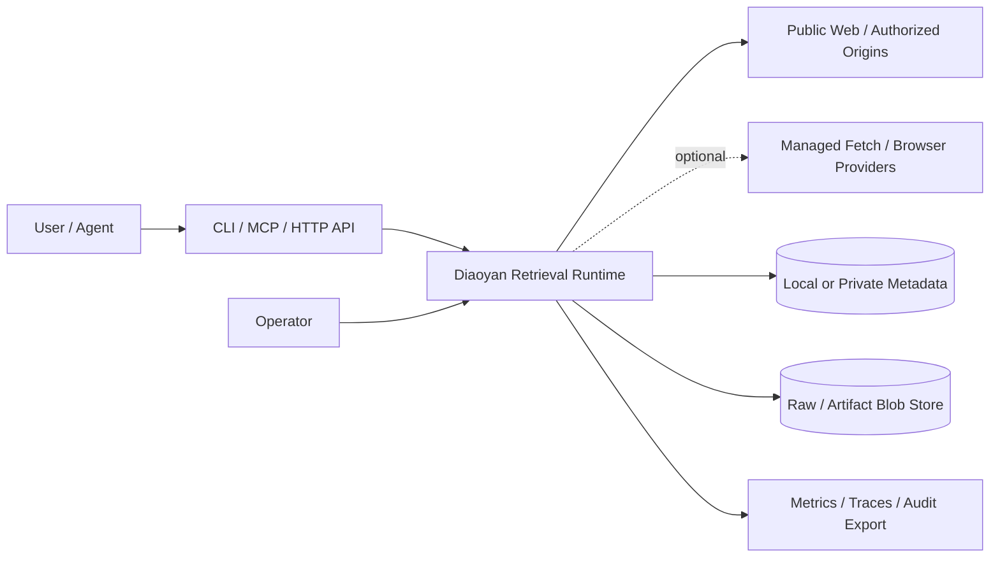
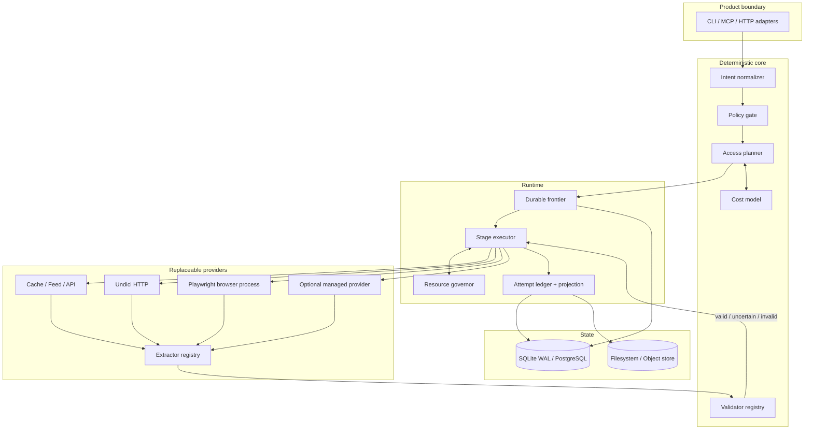
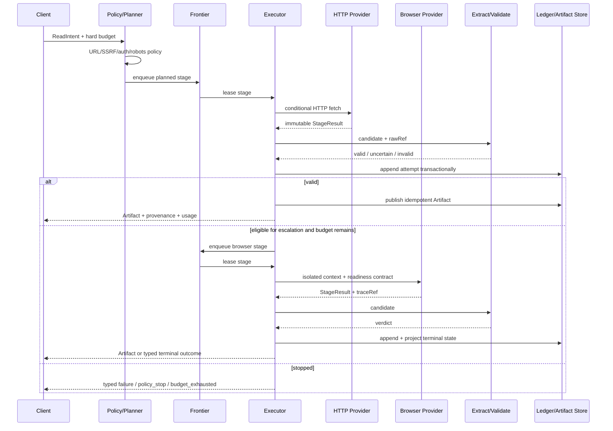
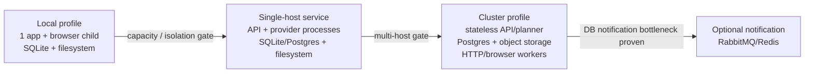

# RFC：Diaoyan 下一代爬虫技术选型与目标架构

状态：Proposed，受控 HTTP 引擎与 Browser Readiness Tournament 已完成；等待真实工作负载与 Provider Benchmark
日期：2026-08-28
研究依据：[crawler-architecture-landscape.md](./crawler-architecture-landscape.md)
真值合同：[reliability-benchmark-spec.md](./reliability-benchmark-spec.md)

## 1. 决策摘要

推荐采用 **模块化耐久内核 + 可替换执行器 + 渐进式部署**，而不是整体套用某个现成爬虫框架，
也不在 P0 直接复制 Firecrawl 式微服务拓扑。

核心选型：

| 节点 | P0 选择 | 扩展选择 | 选择原因 |
| --- | --- | --- | --- |
| 控制面语言 | TypeScript / Node.js | 保持不变 | 现有代码、MCP、Web、Playwright 同栈；瓶颈尚不在运行时 |
| HTTP | Undici Provider | 生产 trace 触发后可加 Go Worker | 受控基准证明 Node 足够启动，也证明 Go 在纯 HTTP 热路径有显著上限优势；保留替换边界 |
| Browser | Playwright Core + 本机 Chrome，独立进程/容量池 | Browserless/Browserbase/自建远程池 Provider | 复用当前能力，隔离 Chrome 故障和资源预算 |
| Local metadata/frontier | SQLite WAL | PostgreSQL | 单文件部署与事务去重；多机时平滑切换权威库 |
| Cluster metadata/frontier | 不在 P0 部署 | PostgreSQL lease + `SKIP LOCKED` | 多 Worker 事务领取成熟，不需先引入消息中间件 |
| Blob | 本地 content-addressed filesystem | S3 兼容 object storage | 原始证据不可变、便于去重和保留策略 |
| Queue transport | 数据库 lease | 可选 RabbitMQ 通知 | 权威状态只有一份；通知层按实测添加 |
| Extraction | 确定性 Registry：JSON/feed/sitemap/PDF/article/JSON-LD | Python/模型/站点 Adapter Worker | 热路径可解释，昂贵能力按需启用 |
| Validation | 独立版本化 Validator | 站点/Schema validator plugin | 防止 Provider 把 2xx、登录墙或残缺内容当成功 |
| 可观测性 | append-only Attempt + metrics + trace refs | OpenTelemetry exporter | 先保证证据语义，再选择后端 |

架构的核心不是 `HTTP -> Browser fallback`，而是：

```text
Intent -> Policy -> Plan -> Durable Frontier -> Provider -> Extract -> Validate
                                      |                         |
                                      +---- Attempt Ledger <----+
                                                        |
                                                  Valid Artifact
```

Provider 只能产生候选结果；只有 Validator 能产生 `valid`。系统允许 attempt 至少执行一次，但对外
Artifact 发布必须幂等。错误、预算耗尽和政策停止都是一等终态，禁止静默降级。

## 2. 背景与决策范围

当前代码是 TypeScript 的本地优先 Reader，已有 CLI/MCP/HTTP、Undici、Playwright、SQLite cache、
抓取策略、job、monitor、metrics 和合规相关模块。现有内部设计投入较小，本 RFC 不保护内部类或目录；
在没有明确破坏性产品决策前，只保护 [spec.md](./spec.md) 中已经交付的外部行为。

本 RFC 决定：

- 控制面和执行面的边界；
- HTTP、Browser、存储、Frontier、队列、提取和验证技术；
- 本地版如何演进到单机服务和多机集群；
- 哪些条件才允许增加新语言、中间件或托管 Provider；
- 实施前必须通过的可量化验证。

本 RFC 不决定：

- 绕过验证码、访问控制、付费墙或站点政策的能力；
- 代理供应商采购；
- 未经用户授权上传 Cookie/Profile；
- “覆盖整个互联网”的搜索引擎索引；
- 具体云厂商和商业价格。

## 3. 需求与约束

### 3.1 工作负载

同一内核需要支持五类 workload，但不要求同一部署同时优化所有类型：

| Workload | 交付 | 主要约束 |
| --- | --- | --- |
| `read(url)` | 同步或短轮询，单 Artifact | 低延迟、错误透明、授权安全 |
| `crawl(seed, bounds)` | 异步 Job，多 Artifact | durable frontier、去重、politeness |
| `monitor(target)` | 定时增量 | freshness、条件请求、变更证据 |
| `extract(url, schema)` | 结构化 Artifact | schema validity、版本化 extractor |
| `authorized_read` | 绑定用户 Profile | origin 隔离、串行会话、审计和本地优先 |

### 3.2 架构不变量

1. 每次网络、浏览器、解析和验证尝试都有可追溯记录。
2. `valid`、`uncertain`、`failed`、`policy_stop` 不得合并成布尔 success。
3. 所有预算都是硬边界；超出后失败，不 warning 后继续花费。
4. URL 去重不丢失 requested URL、最终 URL 和 declared canonical 之间的证据。
5. robots、SSRF、redirect 和授权检查发生在每次真正访问之前，而非只检查 seed。
6. Worker 崩溃后 lease 可回收；已发布 Artifact 不重复对外交付。
7. 授权 Profile 默认只留在本机，并绑定允许的 origin。
8. Browser、外部 Provider、模型和代理都是可禁用、可计量的能力。

## 4. 候选架构

评分为当前需求权重下的设计分析，不是 Benchmark 成绩。1 分最弱，5 分最强。

权重：可信结果 25、本地可运维 15、到首个 Benchmark 的速度 15、扩展性 10、成本控制 15、
可替换性 10、恢复/可观察性 10。

| 方案 | 可信 | 本地 | 速度 | 扩展 | 成本 | 替换 | 恢复 | 加权分 |
| --- | ---: | ---: | ---: | ---: | ---: | ---: | ---: | ---: |
| A. 直接以 Crawlee 为核心 | 4 | 4 | 5 | 3 | 3 | 4 | 3 | 76/100 |
| B. 立即建设 Firecrawl 式微服务 | 4 | 2 | 2 | 5 | 3 | 4 | 4 | 67/100 |
| C. 模块化耐久内核，渐进部署 | 5 | 5 | 4 | 4 | 5 | 5 | 5 | **95/100** |
| D. 托管 Provider 路由器 | 4 | 3 | 5 | 5 | 2 | 4 | 2 | 72/100 |

### 4.1 A：直接以 Crawlee 为核心

方案：用 Crawlee RequestQueue、AutoscaledPool、BrowserPool 和 crawler 类替代大部分 runtime。

- 优点：最快获得成熟调度、浏览器池和请求持久化；TypeScript 技术栈一致。
- 缺点：Diaoyan 仍需另建 policy、attempt、artifact truth、授权和成本合同；Adaptive crawler 实验性；
  容易形成两套 scheduler/result 状态。
- 适用条件：如果原型证明自有 Frontier/BrowserPool 没有差异化，且状态可一一映射，可重新评估。
- 当前决定：可用来做对照 prototype，不作为权威内核。

### 4.2 B：立即建设微服务

方案：API、Planner、HTTP Worker、Browser Worker、Extractor Worker、PostgreSQL、Redis、RabbitMQ、
对象存储从第一天独立部署。

- 优点：故障域清晰，组件可分别扩缩，多机上限高。
- 缺点：还没基准就支付部署、协议、版本和一致性成本；本地用户体验差；每个边界都会拖慢真值
  Harness 的建立。
- 适用条件：已有明确的多租户并发、SLA、独立团队和容量数据。
- 当前决定：不选；保留相同逻辑边界，使未来拆进程不必重写领域合同。

### 4.3 C：模块化耐久内核，渐进部署（推荐）

方案：P0 是单应用进程、独立 Browser 子进程、SQLite WAL 和本地 blob；组件通过明确 port 交互，
不经网络 RPC。集群 profile 将 metadata/frontier port 换成 PostgreSQL，Provider 变为独立 Worker，
业务状态机不变。

- 优点：本地最简单；最快建立真值和故障注入；不会封死多机演进；能按证据添加复杂度。
- 缺点：需要自己实现有限的 Frontier、lease 和状态投影；团队必须维护清晰边界，避免重新耦合。
- 当前决定：选定。

### 4.4 D：托管 Provider 路由器

方案：只自建 Intent/Policy/Planner/Validator/Ledger，所有网络访问委托给 Zyte、Bright Data、
Browserbase、Firecrawl、Tavily 等服务。

- 优点：最快覆盖复杂站点，弹性和浏览器运维转移给供应商。
- 缺点：单位成本、错误语义、数据边界和供应商行为不可完全控制；离线/本地优先目标受损。
- 适用条件：企业显式允许外发，且同 URL Benchmark 证明 cost per valid 更优。
- 当前决定：作为可选末级 Provider，不作为默认架构。

## 5. 目标架构

### 5.1 System Context



信任边界：用户凭证只进入明确授权的 Browser Provider；默认本地 Profile 不进入托管 Provider。
所有外部访问先通过 Policy Gate。

### 5.2 Container/Component View



依赖方向：Core 只依赖纯合同；Runtime 依赖 Core ports；Provider/Store 实现 ports。CLI/MCP 不直接调用
Playwright、SQLite 或外部服务。

### 5.3 一次请求的时序



## 6. 核心数据模型与一致性

### 6.1 权威记录

| Record | 可变性 | 关键字段 | 所有者 |
| --- | --- | --- | --- |
| Request | 只追加输入 + 当前投影 | intent、tenant、budget、state、version | Runtime |
| FrontierEntry | lease 期间可变 | request、origin、priority、dueAt、leaseOwner/expiry | Frontier |
| Attempt | append-only | plan/stage/provider/version、outcome、usage、rawRef、traceRef | Ledger |
| RawObject | immutable | sha256、mediaType、bytes、retention class | Blob Store |
| Artifact | immutable | content hash、extractor/validator version、provenance | Artifact Store |
| CurrentProjection | 事务更新 | terminal state、current artifact、last attempt | Ledger projector |
| OriginState | 有限可变 | nextAllowedAt、inFlight、robots expiry、backoff | Frontier/Policy |

不采用“所有状态都事件溯源”。Attempt 保持不可变证据，CurrentProjection 用事务维护查询效率。这样既能
审计，又避免为了重建一个页面状态回放全部事件。

### 6.2 交付语义

- 执行语义：at-least-once。Worker 在提交 attempt 前崩溃，lease 到期后可重跑。
- 发布语义：幂等。`requestId + artifactHash + validatorVersion` 形成 publication key。
- 不宣称 exactly-once 网络访问；目标站可能看到重复请求。
- retry 只重试声明为 retryable 的 stage，不从头重复已成功的昂贵阶段。
- cancel 是持久状态；Worker 在网络、提取、浏览器步骤之间检查取消和 deadline。

### 6.3 URL identity

系统分别保存：

- `requestedUrl`：调用方证据；
- `normalizedFetchUrl`：去 fragment、规范 scheme/host/default port，用于初始 dedupe；
- `finalUrl`：redirect 后实际地址；
- `declaredCanonicalUrl`：页面声明，仅作为证据，不能自动覆盖 identity。

默认不删除 query 参数、不合并不同授权上下文。将 canonical 作为强去重键必须由版本化站点规则证明。

## 7. 调度、礼貌和资源治理

### 7.1 Frontier 排序

推荐逻辑顺序：

```text
eligible = dueAt <= now
order by effectivePriority DESC, dueAt ASC, discoveredAt ASC
partition/account by originKey = scheme + host + effectivePort + identityScope
```

`effectivePriority` 由用户优先级、深度、任务 fairness 和 aging 组成。它不能绕过 `nextAllowedAt`、
预算或政策停止。

### 7.2 三层容量控制

1. 全局：进程 CPU、RSS、事件循环延迟、open sockets、磁盘和总在途任务。
2. Provider：HTTP connections、Browser processes/contexts/pages、外部 Provider quota。
3. Origin：并发、最小间隔、429/503 backoff、robots policy、授权 session serialization。

提高全局并发不能覆盖 origin 上限。Browser slot 与 HTTP slot 分开计算，防止 Chrome 压力让健康 HTTP
任务饥饿。

### 7.3 robots 与政策

遵循 [RFC 9309](https://www.rfc-editor.org/rfc/rfc9309.html)。Policy Gate 在 seed、redirect 每一跳和
浏览器主导航前执行；子资源采用显式 browser network policy。robots 获取失败、解析失败、缓存过期
各自有类型化状态，不用 permissive warning 静默放行。

## 8. Provider 技术选择

### 8.1 HTTP：保留 Undici

选择理由：现有依赖；原生 Node 异步 I/O；连接池、超时和流式 body 能覆盖 P0；可与当前测试替身结合。
Provider 必须实现：

- connect/headers/body/deadline 分段超时；
- redirect 每跳政策复检；
- 压缩后与解压后 byte limit；
- 条件请求、内容类型 sniffing、可取消流；
- 明确 DNS/IP 解析与 SSRF 防护；
- 只返回 StageResult，不执行 browser fallback。

增加 Go/Rust Worker 的门槛：在代表 Corpus 中，HTTP worker 持续 CPU 超过 70%，queue wait 的主要
归因是 Node 运行时而非 origin/network，且原型把 `cost_per_valid_artifact` 或同等容量成本改善至少
25%，无可靠性退化。三项必须同时成立。

### 8.2 Browser：Playwright Core，进程隔离

对比：

| 选择 | 评价 |
| --- | --- |
| Playwright | 自动等待、context 隔离、trace/CDP 能力完整，当前已有 |
| Puppeteer | Chrome/CDP 生态成熟，但迁移没有当前可测收益 |
| 直接 CDP | 控制最细，需自建等待、兼容和生命周期，维护成本高 |
| Selenium/WebDriver | 跨浏览器成熟，但对本项目无明显优势 |
| 托管 Browser | 弹性与观察好，但增加费用、延迟和数据边界 |

Browser Provider 采用独立进程/worker thread 之外的进程边界，原因是 Chrome 崩溃、内存泄漏和 CPU
争用需要与 API 隔离。匿名 read 默认每任务新 BrowserContext；浏览器进程有限复用。授权 Profile
绑定 origin，同一 Profile 默认串行，绝不自动发送到远程 Provider。

readiness 不是固定 sleep，而是可组合合同：主导航完成、目标 selector/内容断言、DOM 稳定窗口、
最大 deadline。`networkidle` 不能作为所有站点的充分条件。

2026-08-28 的 5 类受控页面、每类 5 次重复结果进一步确定了优先级：固定 750ms 的 Valid Rate/False
Success 分别为 40%/60%，全页正文稳定为 60%/20%，显式目标条件加预算化交互为 100%/0%；三者有效
结果 median 分别为 765ms、1,244ms、624ms。该小型受控集不证明公开网络的总体成功率，但足以否决
“固定等待作为成功条件”，也证明“全页稳定作为唯一条件”会在持续变化和无限滚动页失效。

因此 ReadinessPolicy 按以下优先级组合：

1. Intent/Adapter 提供的目标 selector、字段断言或终态条件；这是完成语义的首选真值。
2. 未知普通正文页使用正文长度与稳定窗口作为 Generic fallback。
3. scroll/click 等动作必须由显式 InteractionPolicy、scope 和预算授权；Generic fallback 不主动交互。
4. 全页指纹超时只说明“通用条件无法确认”，不能证明页面无有效正文；Planner 可转入 Adapter、uncertain 或失败。

### 8.3 托管 Provider

统一接口：

```ts
interface FetchProvider {
  capabilities(): ProviderCapabilities;
  execute(stage: PlannedStage, signal: AbortSignal): Promise<StageResult>;
}
```

Provider capability 必须声明 region、credential handling、browser/action、raw response、费用模型、
retention 和 typed errors。Planner 只有在用户允许、数据边界允许且预算足够时选择它。

## 9. Extraction 与 Validation

### 9.1 提取顺序

```text
declared media type + sniff
  -> JSON / JSON-LD
  -> RSS / Atom / Sitemap
  -> PDF/document
  -> versioned site adapter
  -> generic article/readability
  -> generic DOM fallback
  -> optional schema/model extractor
```

原始响应只写一次，多个 extractor 可以从相同 `rawRef` 派生不同 Artifact。Artifact key 包含 extractor
版本、配置 hash 和原始内容 hash，升级算法不会污染旧结果。

### 9.2 真值判定

Validator 输入 `ReadIntent + CandidateArtifact + navigation evidence + provider evidence`，输出：

- `valid`：任务必需断言全部通过；
- `uncertain`：可以交付但不能计入 Valid Result Rate；
- `invalid`：证据确认错误/残缺，可触发预算内升级；
- typed terminal：policy、auth、unsupported、budget、provider failure。

通用 gate validator 至少识别空壳、登录、付费、challenge、错误模板、内容过短、schema 不满足、
canonical/目标身份冲突。站点 validator 必须版本化并有 fixture，不允许把 LLM 自信度直接当 valid。

## 10. 部署演进



| Profile | 状态 | 进程 | 目标 |
| --- | --- | --- | --- |
| Local | SQLite WAL + local CAS | app + browser child | 零服务依赖、用户凭证本地 |
| Single-host | SQLite 或 PostgreSQL + local/S3 | API + HTTP/browser workers | 故障隔离、较高并发 |
| Cluster | PostgreSQL + object storage | stateless API/planner + worker pools | 多租户、多机弹性 |

迁移 SQLite→PostgreSQL 的触发条件满足任一即可评审：需要多主机 Worker；持续 writer wait p95 超过
20 ms 并成为 queue 延迟主因；单机恢复/备份达不到产品 SLO。不是因为“以后可能变大”而迁移。

## 11. 安全与权限边界

- URL 入口、redirect、DNS 解析后地址都执行 SSRF policy；禁止访问未授权私网/metadata endpoint。
- 响应头、body、解压、redirect、页数、深度、总 bytes 和 browser time 都有硬上限。
- Cookie、Authorization、client certificate 和持久 Profile 是 secret，不写普通日志和 Artifact。
- 授权 Profile 绑定 tenant + allowed origins；跨 origin redirect 默认停止。
- Browser 下载、弹窗、外部协议、service worker、WebRTC 和文件访问默认禁用或显式受控。
- P0 plugin 是仓库内受信代码并经注册；第三方任意代码若未来支持，必须进隔离进程/容器。
- 外部 Provider 默认只接收公开 URL；含私有 query、header、Cookie 的请求需用户明确选择数据边界。
- robots、RSL、Web Bot Auth 和付费授权结果写入审计证据，不以“访问成功”替代许可。

涉及 auth、secrets、付款和任意脚本执行的代码必须人工安全审查。

## 12. 可测成功标准

这些是进入实现阶段的初始工程门槛，不是已经达到的结果；完成第一轮 baseline 后可通过 ADR 调整，
不能为了过门槛修改真值断言。

### P0 正确性

- Hermetic gate/shell/error fixtures 的 False Success 为 0。
- 受控进程 kill 后，已接受 Request 丢失数为 0；允许 attempt 重跑，对外重复 Artifact 为 0。
- robots、origin delay、redirect policy 违规数为 0。
- 同一输入、相同版本、相同原始内容的 Artifact hash 100% 稳定。
- 所有 terminal outcome 都有至少一个 Attempt 和类型化原因。

### P0 容量基线

- 参考开发机上排队 100,000 个 metadata-only FrontierEntry，应用 RSS（不含 Chrome）低于 300 MiB。
- 4 个 HTTP Worker、无 origin wait 的受控负载下，lease 获取 p95 低于 10 ms。
- 浏览器达到配置内存/slot 上限时，新任务留在 Frontier，不使 API 进程 OOM。
- cache/HTTP/browser/validate 的分段耗时与资源用量覆盖率 100%。

容量数字用于发现数量级错误，不代表线上 SLA。业务目标必须在 Corpus baseline 后以 Valid Result Rate、
False Success Rate、Browser Uplift、Valid Latency 和 Cost per Valid Artifact 定义。

## 13. 风险与缓解

| 风险 | 影响 | 缓解/否证方式 |
| --- | --- | --- |
| 自研 Frontier 重复造轮子 | 延迟交付、隐藏 bug | 只做 priority/due/lease/dedupe 最小集；与 Crawlee prototype 做恢复对照 |
| SQLite 单写者过早到顶 | queue wait 上升 | WAL、短事务、批写；用明确门槛迁 PostgreSQL |
| Validator 误判 | 错误成功或无谓 browser 升级 | 三值结果、fixture 真值、版本化、按类别报告混淆矩阵 |
| Browser 池泄漏或崩溃 | OOM、任务丢失 | 进程隔离、context/page 上限、生命周期回收、lease 恢复 |
| 双存储投影不一致 | 状态与 blob 不匹配 | blob 先写 immutable，DB 事务发布 ref；孤儿对象异步清理 |
| 外部 Provider 锁定 | 成本/数据边界失控 | capability contract、统一 StageResult、同 URL Benchmark、默认关闭 |
| 过早多语言 | 构建和运维复杂 | 只在 25% 改善门槛后增加 Go/Rust Worker |
| Plugin 破坏安全边界 | secret/网络泄漏 | P0 仅受信 registry；第三方代码必须隔离和 capability allowlist |
| 公开网站漂移 | Benchmark 假回归 | fixture/controlled/live 三层；live case 有审核和过期时间 |

## 14. 实施顺序与决策门

### Phase 0：先建立证据，不改主执行路径

1. 落地 Benchmark schema、受控站点和 20–30 个高价值 fixture。
2. 对当前实现跑 baseline，拆出 valid/invalid/uncertain，而非只看测试通过。
3. 用相同 URL 对 Crawlee prototype、Firecrawl/Jina 等可用 Provider 做小样本对照。

退出条件：能稳定复现 false success、browser uplift、retry waste 和每阶段成本。

### Phase 1：真值和账本

1. 定义 ReadIntent、StageResult、ValidationResult、TypedError。
2. 在当前 Reader facade 后加入 Validator Registry 和 append-only Attempt。
3. Artifact 变为不可变、版本化、content-addressed。

退出条件：P0 正确性门槛通过；公共 CLI/MCP 合同未回归。

### Phase 2：耐久 Frontier

1. SQLite WAL schema、atomic lease、expiry/recovery、origin state。
2. 将 site crawl 从内存 BFS 迁入 Frontier。
3. 加进程 kill、重复领取、取消、磁盘满和 checkpoint 测试。

退出条件：100k 容量和恢复门槛通过。

### Phase 3：Planner 与执行器隔离

1. HTTP、Browser、feed/PDF 变为统一 Provider。
2. 落地硬预算和三层 ResourceGovernor。
3. browser child process、readiness 和 trace reference。

退出条件：HTTP-first 相对 baseline 降低 cost per valid，且 false success 不回归。

### Phase 4：只按触发条件扩展

- 多主机需求触发 PostgreSQL profile。
- 浏览器容量触发独立/远程 Browser Worker。
- Node 热路径门槛触发 Go/Rust HTTP prototype。
- 数据库通知瓶颈触发 RabbitMQ/Redis；不提前引入。

## 15. 需要用户补充的产品事实

以下答案会改变权重或触发架构分支，但不影响 Phase 0 开始：

1. 未来 6 个月的主 workload 比例：单 URL、整站 crawl、monitor、结构化 extract 各约多少？
2. 第一优先部署形态：个人电脑、本地团队服务器，还是多租户云 API？
3. 目标容量：每日 URL 数、单 Job 最大页面数、并发 Job 数、可接受 p95。
4. 授权页面是否是 P0 核心；Cookie/Profile 是否绝对禁止离开本机？
5. 是否允许采购代理、远程 browser 或 extraction API；单次有效结果预算是多少？
6. 合规市场和地区边界，以及 robots/RSL/站点 ToS 的默认政策偏好。
7. 最重要的内容类型和 20 个真实代表 URL（可脱敏）是什么？

若这些答案尚不确定，默认采用：本地优先、公开页面、无绕过、无外部凭证、HTTP-first、单 Job
不超过 10,000 页。默认值只用于建立 Benchmark，不应被写成最终产品承诺。

## 16. 决策状态

当前建议批准：

- C 方案作为目标架构；
- TypeScript/Node 控制面、Undici、Playwright、SQLite→PostgreSQL、filesystem→object storage；
- Validator 和 Attempt Ledger 先于新调度器；
- 所有新基础设施由量化门槛触发。

在用户补充第 15 节事实并完成 Phase 0 baseline 前，不批准：整体重写、微服务化、Go/Rust 重写、
Redis/RabbitMQ/Kafka/Temporal、默认托管 Provider、browser-first。
